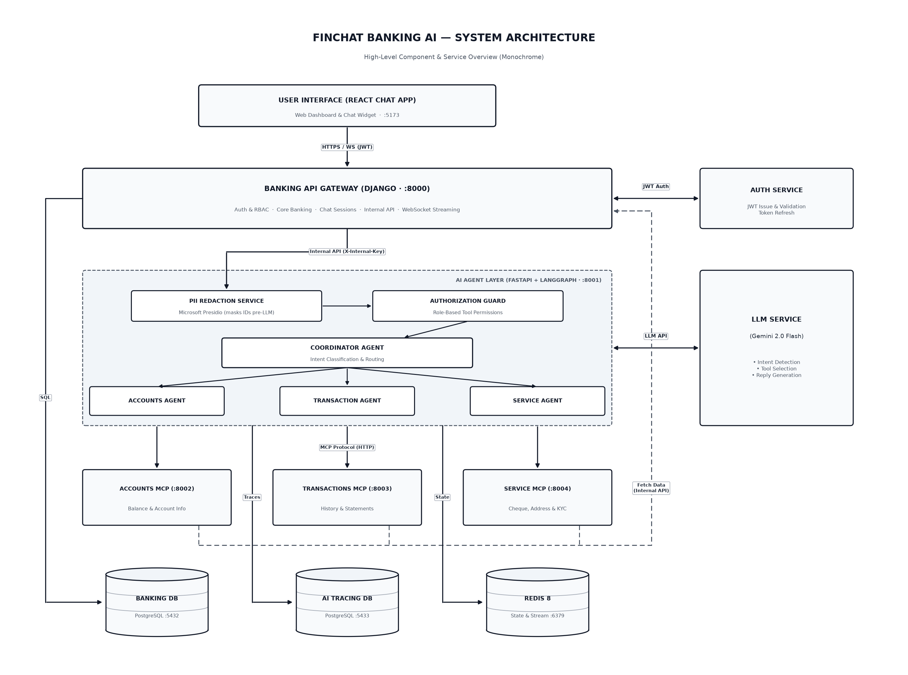

# FinChat Service

FinChat Service is a financial banking and assistant platform built with Django REST Framework (ASGI via Uvicorn), FastAPI, PostgreSQL 18, Redis 8, and React (Vite + Material UI). It provides role-based access control, account management, deposits, withdrawals, transfers, cheque book requests, USD currency endorsements, address management, structured JSON logging, and a multi-service chat pipeline.



## Folder Structure

```text
fin-chat-service/
├── backend/              Django REST API (ASGI), PostgreSQL models, seeder, tests
├── frontend/             React + TypeScript + Material UI application
├── ai-service/           FastAPI AI orchestration service (echo plumbing)
├── accounts-mcp/         Accounts MCP server 
├── transactions-mcp/     Transactions MCP server 
├── service-mcp/          Service MCP server 
├── diagram/              Architecture diagrams and generator scripts
├── ARCHITECTURE_GUIDE.md Architecture & phased implementation guide
├── docker-compose.yml    PostgreSQL 18 (bank-db, ai-db), Redis 8, backend, AI, and MCP services
├── .env.example          Environment configuration template
└── README.md
```

## Prerequisites

- Docker and Docker Compose
- Node.js (v20 or later) and npm

## Quick Start

### 1. Environment Setup

Copy the example environment file if `.env` does not exist:

```bash
cp .env.example .env
```

Add your Gemini API key to `.env` (required for `ai-service`):

1. Open [Google AI Studio](https://aistudio.google.com/apikey) and create an API key.
2. Set `GEMINI_API_KEY` (and optionally `GEMINI_MODEL`) in `.env`:

```env
GEMINI_API_KEY=your-actual-gemini-api-key
GEMINI_MODEL=gemini-2.0-flash
```

For anything beyond local testing, replace `INTERNAL_API_KEY` in `.env` with a strong random secret (for example, `openssl rand -hex 32`).

### 2. Start Services (Docker)

```bash
docker compose up --build --remove-orphans
```

(`--remove-orphans` cleanly removes the legacy `db` container if upgrading from the initial setup while keeping the `pgdata` volume.)

This starts `bank-db` (`:5432`), `ai-db` (`:5433`), `redis` (`:6379`), the Django backend (`:8000` via Uvicorn), `ai-service` (`:8001`), and the three MCP placeholder servers (`:8002`–`:8004`), runs database migrations, and seeds initial roles and test users.

- Backend API: `http://localhost:8000/api/v1/`
- Swagger UI: `http://localhost:8000/api/schema/swagger-ui/`
- Backend Health Check: `http://localhost:8000/api/v1/health/`
- AI Service Health Check: `http://localhost:8001/health`
- Accounts MCP Health Check: `http://localhost:8002/health`
- Transactions MCP Health Check: `http://localhost:8003/health`
- Service MCP Health Check: `http://localhost:8004/health`

### 3. Start Frontend (Local)

In a separate terminal:

```bash
cd frontend
npm install
npm run dev
```

The frontend dev server runs at `http://localhost:5173`. Chat messages are sent to `POST /api/v1/chat/sessions/{id}/agent/`, which forwards requests to `ai-service` (`X-Internal-Key`) and persists the exchange in `bank-db`.

## Seeded Test Users

All seeded users share the same password for local development: `Test@1234`

| Username | Email | Role | Account Number | Initial Balance |
| --- | --- | --- | --- | --- |
| `superadmin` | `superadmin@finchat.local` | `superadmin` | - | - |
| `admin1` | `admin1@finchat.local` | `admin` | - | - |
| `manager1` | `manager1@finchat.local` | `manager` | - | - |
| `customer1` | `customer1@finchat.local` | `customer` | `FC1000000001` | $10,000.00 |
| `customer2` | `customer2@finchat.local` | `customer` | `FC1000000002` | $5,000.00 |
| `customer3` | `customer3@finchat.local` | `customer` | `FC1000000003` | $2,500.00 |

## Database Migrations

Initial migrations are already included. Whenever you add or modify Django models, generate and apply new migrations with:

```bash
docker compose exec backend python manage.py makemigrations
docker compose exec backend python manage.py migrate
```

## Verification Commands

Run backend unit and integration tests:

```bash
docker compose exec backend python manage.py test apps --verbosity=2
```

Run AI service unit tests:

```bash
docker compose exec ai-service pytest -v
```

Validate OpenAPI schema:

```bash
docker compose exec backend python manage.py spectacular --validate
```

Build frontend for type-checking:

```bash
cd frontend && npm run build
```
